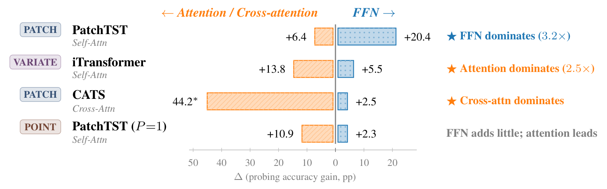
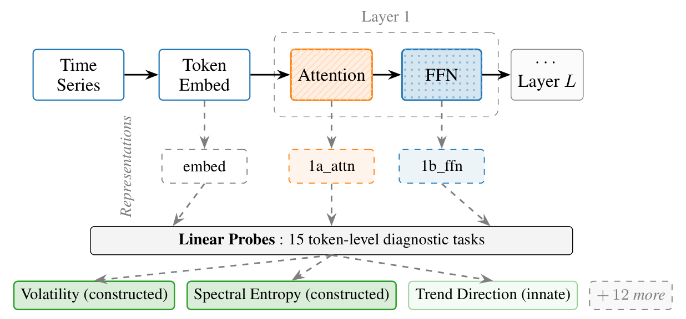

<div align="center">

# Tokenization and Architecture Jointly Allocate Component Roles in Time Series Transformers

**Mingyu Kim** &nbsp;·&nbsp; **Doguk Kim**<sup>†</sup>

Department of Artificial Intelligence, Inha University

<sub><sup>†</sup>Corresponding author</sub>

[](#citation)
<!-- TODO before upload: add the OpenReview forum id, then uncomment
[](https://openreview.net/forum?id=FORUM_ID)
-->
[](LICENSE)

</div>

<p align="center">
  
</p>

**TL;DR.** In time series transformers, the sub-layer that makes temporal properties linearly decodable is allocated by the interaction of tokenization and architecture: the FFN under patch tokens (PatchTST), attention under variate tokens (iTransformer, in probing), the cross-attention path in CATS, and attention under single-scalar tokens, where the FFN adds little.

## News

- **Sep 2026.** Accepted to NeurIPS 2026.

## Overview

<p align="center">
  
</p>

We freeze a trained forecaster and extract representations at the token embedding (`embed`) and after each attention (`1a_attn`) and FFN (`1b_ffn`) sub-layer. Linear probes on these representations predict 15 token-level temporal properties. A sub-layer *constructs* a property when the property becomes linearly decodable from its output, and the per-component deltas attribute the gain:

$$\Delta_{\mathrm{attn}} = \mathrm{Acc}(\mathrm{1a\_attn}) - \mathrm{Acc}(\mathrm{embed}), \qquad \Delta_{\mathrm{FFN}} = \mathrm{Acc}(\mathrm{1b\_ffn}) - \mathrm{Acc}(\mathrm{1a\_attn}).$$

The framework targets models whose probed representations are read by a linear forecasting head; a matched MLP probe already saturates at the embedding.

## Key findings

Supervised models of 5 architectures, 8 long-term forecasting benchmarks:

- **Patch tokens (PatchTST).** The FFN's gain exceeds attention's on all 8 datasets, with a 3.2× ratio of 8-dataset means.
- **Without attention.** The FFN alone reaches nearly the same total gain, both when attention is removed from a trained model and when PatchTST is trained without it; the latter forecasts within a few percent of the full model.
- **Variate tokens and cross-attention.** In probing, attention dominates under variate tokenization (iTransformer), and cross-attention carries nearly all feature transfer in CATS.
- **Single-scalar tokens.** At P=1 the FFN is left with almost no constructed features, while a single additional time point per token (P=2) restores them.
- **Forecasting side.** Activation patching, knockout, and training without attention establish component-level reliance and sufficiency, not where individual features are causally constructed.

## Results at a glance

Layer-1 constructed-task deltas (volatility, diff energy, spectral entropy; 8-dataset means, 9 runs), in percentage points of probe accuracy:

| Model | Tokens | Attention Δ | FFN Δ | Constructing component |
|---|---|---:|---:|---|
| PatchTST | patch | +6.4 | **+20.4** | FFN (3.2×) |
| iTransformer | variate | **+13.8** | +5.5 | attention (2.5×) |
| CATS | patch, cross-attention only | **44.2**\* | +2.5 | cross-attention |
| PatchTST (P=1) | single time point | **+10.9** | +2.3 | attention; the FFN adds little |

\* For CATS the cross-attention entry is absolute accuracy, because its learnable queries start without per-instance input information.


## Citation

If you find this work useful, please cite:

```bibtex
@inproceedings{kim2026tokenization,
  title     = {Tokenization and Architecture Jointly Allocate Component Roles in Time Series Transformers},
  author    = {Kim, Mingyu and Kim, Doguk},
  booktitle = {Advances in Neural Information Processing Systems},
  year      = {2026}
}
```

## License

[MIT](LICENSE). Code copied from upstream repositories will keep its original license.
